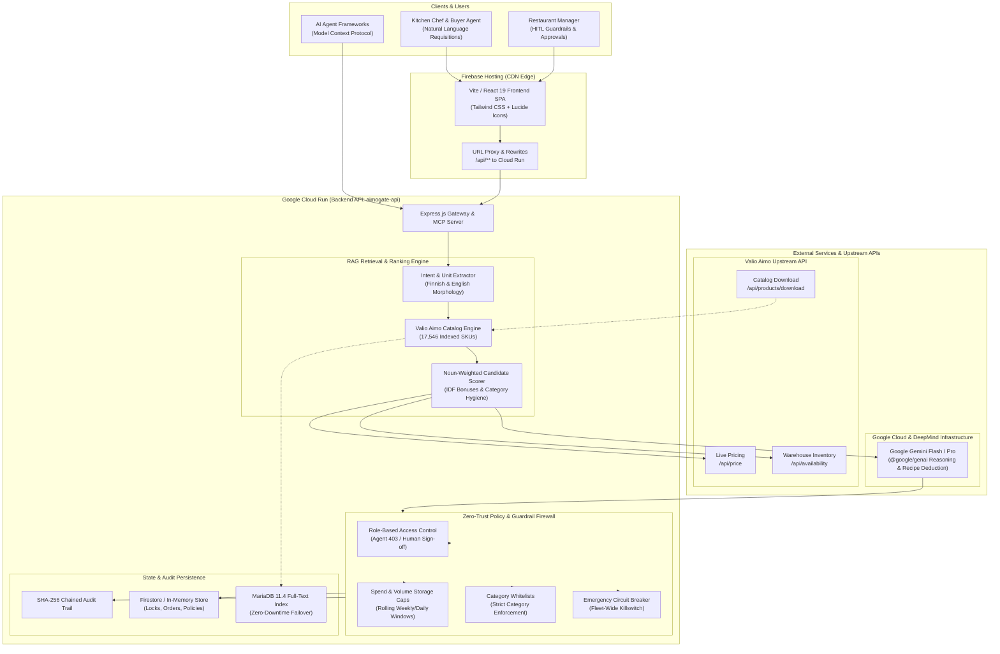

# aimanage — Autonomous B2B Procurement Governance for Valio Aimo

aimanage is an autonomous procurement engine and Zero-Trust policy gateway built for hotel & restaurant kitchens ordering from **Valio Aimo** (Junction 2026 challenge).

It enables kitchen teams to request supplies in plain English, while an autonomous AI buyer agent evaluates price, unit economics, warehouse stock availability, and hotel-specific safety guardrails.

---

## Key Features

1. **RAG Catalog Intelligence (17,546 Valio Aimo SKUs)**:
   - Full-text search and semantic retrieval across all 17,546 official Valio Aimo products.
   - MariaDB fulltext index support with fallback to high-speed in-memory indexing.
   - Live upstream API sync with `https://junction26.valioaimo.fi`:
     - Real-time catalog price and comparison price per litre/kg (`POST /api/price`).
     - Real-time warehouse availability and order cut-off times (`POST /api/availability`).

2. **Google Gemini Flash / Pro Autonomous Reasoning**:
   - Powered by **Google Gemini** via the official `@google/genai` SDK (`gemini-flash-latest`, `gemini-3.8-flash`, `gemini-2.5-pro`).
   - Performs commercial culinary recipe deduction, material BOM formulation, unit economics analysis, and inventory optimization.
   - Generates transparent chain-of-thought audit traces for every procurement proposal (with deterministic unit-economics solver fallback).

3. **Autonomous Governance & Policy Guardrails**:
   - **Spending Caps**: Auto-approves orders within budget (e.g. up to €1,000); flags excess for manager approval.
   - **Category Time Windows & Storage Caps**: Enforces rolling limits (e.g., maximum storage of 1,000L of milk/dairy per week).
   - **Category Rule Time Limits**: Temporary exemptions or limits (e.g. valid for 30 days) to prevent repeated manual approvals.
   - **Single-Restaurant Scoping**: Tailored for the specific restaurant tenant (`hotel_nordic_group`).
   - **Cryptographic Audit Trail**: Integrity-hashed audit log for every transaction and policy decision.

---

## System Architecture



### Architectural Pipeline Flow:
1. **Natural Language Procurement**: Chefs and buyers submit unstructured procurement requests in English or Finnish (e.g. `"50 litraa luomu täysmaitoa"` or `"10kg butter for the bakery"`).
2. **Intent Parsing & Suffix Normalization**: Extracts quantities, unit types, and removes contextual department phrases to prevent keyword hijacking while normalizing Finnish morphological inflections (`täysmaitoa → täysmaito`).
3. **Semantic Catalog Retrieval & Live Upstream Augmentation**: Queries the 17,546 Valio Aimo catalog with noun-weighted term matching, then queries the official Valio Aimo API in real time for live pricing (`/api/price`) and stock availability (`/api/availability`).
4. **Google Gemini Autonomous Reasoning**: Evaluates candidate trade-offs on Google Cloud infrastructure, calculating exact pack requirements, unit economics, dietary compliance, and transparent chain-of-thought traces (with deterministic fallback).
5. **Zero-Trust Policy Firewall**: Validates orders against tenant spending limits, rolling weekly storage volume caps (e.g. 1,000L/week dairy), rule expiration windows (`rule_valid_until`), category whitelists, and emergency circuit breakers before reserving or approving inventory.

---

## Deployment: Option A (Firebase Hosting + Google Cloud Run)

This deployment architecture hosts the frontend on **Firebase Hosting** and the backend API container on **Google Cloud Run** in the same GCP/Firebase project (`junction26hel-7631`).

### Step 1: Deploy the Backend Container to Cloud Run

Deploy the container using the included [Dockerfile](./Dockerfile):

```bash
gcloud run deploy aimogate-api \
  --project=junction26hel-7631 \
  --source . \
  --region=europe-north1 \
  --allow-unauthenticated \
  --set-env-vars="GEMINI_API_KEY=<YOUR_KEY>,GEMINI_MODEL=gemini-flash-latest,VALIO_API_BASE_URL=https://junction26.valioaimo.fi"
```

### Step 2: Deploy Frontend & Rules to Firebase Hosting

[firebase.json](./firebase.json) is configured to automatically route `/api/**` traffic to the `aimogate-api` Cloud Run service in `europe-north1` while serving the Vite React single-page app from `dist/`:

```bash
# 1. Install dependencies & build Vite bundle
npm install
npm run build

# 2. Deploy to Firebase
firebase login
npm run deploy
```

Your application will be live at:
- **`https://junction26hel-7631.web.app`**
- **`https://junction26hel-7631.firebaseapp.com`**

---

## Automated Deployment (One-Click)

Run the automated deployment script directly in Cloud Shell or your authenticated terminal:

```bash
# Pull latest and run full automated deployment (tests, Cloud Run, Firebase Hosting)
./deploy.sh
# OR via npm:
npm run deploy:full
```

This single command:
1. Runs regression tests (`aimogate.test.ts`, `rag.test.ts`) and TypeScript linting.
2. Builds the Vite production bundle.
3. Builds and deploys the Cloud Run service `aimogate-api` with the Google Gemini reasoning engine and Valio Aimo credentials.
4. Deploys Firebase Hosting with the `/api/**` rewrite to Cloud Run.
5. Verifies live health on the catalog status endpoint (`/api/v1/catalog/status`).

---

## Continuous Deployment (GitHub Actions)

A GitHub Actions workflow is provided at `.github/workflows/deploy.yml`. When you push to `main`, it automatically runs unit tests and builds artifacts. To enable direct continuous deployment from GitHub:
1. In your GitHub repo settings (**Settings -> Secrets and variables -> Actions**), add:
   - `GCP_SA_KEY`: Service account JSON key with `roles/run.admin` and `roles/iam.serviceAccountUser`.
   - `FIREBASE_TOKEN`: Firebase CI token (generated via `firebase login:ci`).

---

## Local Development

```bash
# Install dependencies
npm install --legacy-peer-deps

# Run local development server (Express API + Vite frontend)
npm run dev

# Run unit tests (Policy Engine & RAG Pipeline)
DISABLE_REMOTE_LLM=true npx tsx src/lib/aimogate.test.ts
DISABLE_REMOTE_LLM=true npx tsx src/lib/rag.test.ts

# Production build test
npm run build
```

---

## Docker Compose (Self-Hosted Option)

To run both the application server and MariaDB container locally or on an external VM:

```bash
docker compose up -d --build

# Ingest all 17,546 Valio Aimo products into MariaDB
docker compose exec aimogate-app npx tsx scripts/ingest_catalog_mariadb.ts
```
